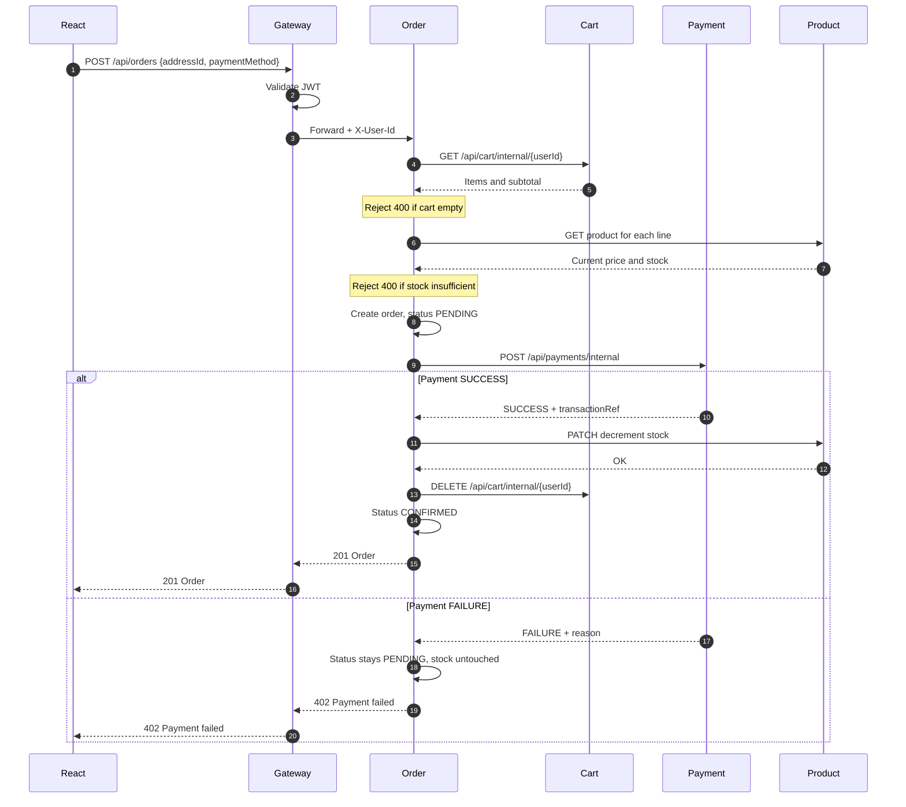

# ShopSphere — Service Boundaries and Port Map

| Field               | Value                       |
| ------------------- | --------------------------- |
| Version             | 1.0                         |
| Date                | 01 September 2026           |
| Companion documents | `SRS.md`, `api-contract.md` |

---

## 1. Port map

Fixed on day 0. Nobody changes a port without updating this table and telling the other two developers.

| #   | Component            | Port | Owner  | Started            |
| --- | -------------------- | ---- | ------ | ------------------ |
| 1   | Eureka Server        | 8761 | Dev A  | First              |
| 2   | API Gateway          | 8080 | Dev A  | Second             |
| 3   | Registration Service | 8081 | Dev A  | Any order          |
| 4   | Auth Service         | 8082 | Dev A  | Any order          |
| 5   | Product Service      | 8083 | Dev B  | Any order          |
| 6   | Cart Service         | 8084 | Dev B  | Any order          |
| 7   | Wishlist Service     | 8085 | Dev B  | Any order          |
| 8   | Order Service        | 8086 | Dev C  | Any order          |
| 9   | Payment Service      | 8087 | Dev C  | Any order          |
| 10  | Review Service       | 8088 | Dev B  | Any order          |
| —   | MySQL                | 3306 | Shared | Before everything  |
| —   | React (Vite)         | 5173 | Dev C  | Any time           |
| —   | SonarQube            | 9000 | Dev A  | Only when scanning |

**Startup order.** MySQL, then Eureka, then wait for it to be fully up, then the gateway and services in any order. A service starting before Eureka will retry, but the registry can take up to 30 seconds to show it, which looks like a failure during a demo when it isn't.

Only the gateway port is ever typed into a browser, Postman collection, or Axios call. Ports 8081–8088 appear in exactly two places: each service's own `application.properties`, and this table.

### Checking for port conflicts

```
netstat -ano | findstr :8083
```

Windows sometimes holds a port after a crashed run. Kill the PID before restarting.

---

## 2. Service boundaries

### 2.1 The rule

Each business service owns exactly one MySQL schema and is the only component permitted to read or write it.

Foreign key constraints exist **inside** a schema. No foreign key crosses a schema boundary. Where a service must reference data owned by another, it stores the identifier as a plain `BIGINT` and fetches the rest through the owning service's API.

If a developer finds themselves wanting to write a `JOIN` across two schemas, the boundary is in the wrong place or the call belongs over HTTP. It is never correct to add a second datasource to a service.

### 2.2 Ownership table

| Service      | Schema                | Tables                   | Owns the concept of          |
| ------------ | --------------------- | ------------------------ | ---------------------------- |
| Registration | `shopsphere_user`     | `users`, `addresses`     | Who a person is              |
| Auth         | `shopsphere_auth`     | `credentials`            | Proving who they are         |
| Product      | `shopsphere_product`  | `products`, `categories` | What is for sale             |
| Cart         | `shopsphere_cart`     | `carts`, `cart_items`    | What someone intends to buy  |
| Wishlist     | `shopsphere_wishlist` | `wishlist_items`         | What someone might buy later |
| Order        | `shopsphere_order`    | `orders`, `order_items`  | What someone actually bought |
| Payment      | `shopsphere_payment`  | `payments`               | Whether they paid            |
| Review       | `shopsphere_review`   | `reviews`                | What they thought of it      |

The "owns the concept of" column is the useful one. When you're unsure which service a new feature belongs to, ask which concept it modifies.

### 2.3 Why Registration and Auth are separate

They share the notion of a user, which invites the question of why they aren't one service. The requirements doc lists them as separate mandatory services (#3 and #4), so the decision is made for you — but there is a real reason, and you should be able to give it in the viva:

Registration owns **identity** — name, email, phone, addresses. Auth owns **credentials** — the password hash and the role. Registration never sees a password: at signup it creates the profile, then calls `POST /api/auth/internal/credentials` with the raw password, and Auth hashes and stores it. If credentials are ever compromised, the profile data is in a different schema entirely.

### 2.4 Data that is deliberately duplicated

Copying data across a boundary is correct when the copy represents a historical fact rather than a live value.

| Where         | Copied field                 | Why                                                                                                        |
| ------------- | ---------------------------- | ---------------------------------------------------------------------------------------------------------- |
| `order_items` | `product_name`, `unit_price` | An order must show what was bought at the price paid, even if the product is renamed, repriced, or deleted |
| `orders`      | Full delivery address        | The order must show where it actually shipped, even if the customer later edits or deletes that address    |
| `reviews`     | `user_name`                  | Renders the review list without calling the User Service once per review                                   |

By contrast, cart items and wishlist items **fetch product data live** on every read, because they represent present intent, not history. A cart should show today's price.

This distinction is the single most likely deep question in the viva. Rehearse the answer: _history is snapshotted, intent is fetched live._

### 2.5 What lives in `common-lib`

Shared across all services, owned by Dev A:

- Cross-boundary DTOs (see `api-contract.md` §12)
- `ResourceNotFoundException`, `BusinessException`, `UnauthorizedException`
- `GlobalExceptionHandler` — the `@RestControllerAdvice`
- `LoggingAspect` — the AOP aspect using SLF4J
- `ApiError` response envelope

`common-lib` has no `Application` class and no `spring-boot-maven-plugin`. It is a plain jar. Nothing in it may depend on any service.

---

## 3. Inter-service dependency matrix

Rows call columns. Blank means no dependency.

| Caller ↓ / Callee → | Auth               | Registration   | Product         | Cart        | Order          | Payment         |
| ------------------- | ------------------ | -------------- | --------------- | ----------- | -------------- | --------------- |
| **Gateway**         | Validate token     |                |                 |             |                |                 |
| **Registration**    | Create credentials |                |                 |             |                |                 |
| **Cart**            |                    |                | Price, stock    |             |                |                 |
| **Wishlist**        |                    |                | Product detail  |             |                |                 |
| **Order**           |                    | Address lookup | Stock decrement | Read, clear |                | Process payment |
| **Review**          |                    |                |                 |             | Purchase check |                 |

Observations worth stating in the viva:

- **Product depends on nothing.** It is a leaf service. Build it first — it unblocks Cart, Wishlist, and Order.
- **Order depends on four services.** It is the orchestrator and the last thing you build. Everything it needs must be stable first.
- **There are no cycles.** No service calls a service that calls it back. This is not accidental — a cycle means the boundary is wrong, and it also causes startup deadlocks if anyone adds eager health checks.
- **Payment calls nothing.** It receives a request, records it, responds. Keeping it that simple is what makes it easy to test.

### Build order implied by the matrix

```
Eureka, Gateway, common-lib
        ↓
Auth, Registration, Product        (parallel — no dependencies among them
        ↓                           except Registration → Auth)
Cart, Wishlist, Review
        ↓
Order, Payment
```

---

## 4. Checkout sequence

The only flow spanning four services, and the flow you will demo. Every other operation in the system is single-service CRUD.



### Ordering decisions, and why

**Stock is checked before payment but decremented after.** Checking early gives the customer a fast, clear rejection. Decrementing late means a failed payment never silently consumes inventory (NFR-REL-03). There is a small race — two customers can both pass the check for the last unit — which is acceptable at demonstration scale. If asked, the production answer is a reservation with a timeout, which is listed as out of scope in the SRS. Knowing why you didn't build it scores better than building it badly.

**The cart is cleared last.** If clearing fails, the order still exists and the customer can retry emptying the cart. Reverse that order and a failure mid-flow loses the cart with no order to show for it.

**The order row is created before payment, not after.** A `PENDING` order gives the failed payment something to attach to, so `payments` always references a real order and FR-PAY-04 (persist every attempt, including failures) is satisfiable.

**Payment failure is HTTP 200 from Payment, 402 from Order.** The payment attempt was processed correctly — it just didn't authorise. Order reads the `status` field, not the HTTP code, and translates to `402` for the client.

### Failure paths to demonstrate

Have all four ready before the evaluation. Parameter #3 rewards showing the system handles failure, not just the happy path.

| Scenario             | How to trigger                    | Expected                                  |
| -------------------- | --------------------------------- | ----------------------------------------- |
| Empty cart           | Checkout with nothing in cart     | 400, readable message                     |
| Insufficient stock   | Set stock to 1, order 5           | 400 naming the product                    |
| Payment declined     | Order a total ending in `.99`     | 402, order stays PENDING, stock unchanged |
| Product service down | Stop product-service, add to cart | 503, readable message, gateway stays up   |

That last one is the one teams forget. Stop a service mid-demo and show the system degrading gracefully rather than throwing a stack trace at the user. It directly evidences NFR-REL-01 and NFR-REL-02.

---

## 5. Boundary rules — quick reference

Pin this where all three of you can see it.

1. Client code never references a port other than 8080.
2. No `@ManyToOne` to an entity owned by another service.
3. No foreign key crossing a schema.
4. No second datasource in any service.
5. `/internal/**` is never routed by the gateway.
6. Downstream services trust `X-User-Id`; only the gateway parses the JWT.
7. Shared DTOs live in `common-lib` and changes are announced before pushing.
8. History is snapshotted; intent is fetched live.
9. No service calls a service that calls it back.
10. Every service writes its own log file under `logs/`.

---

_End of document._
